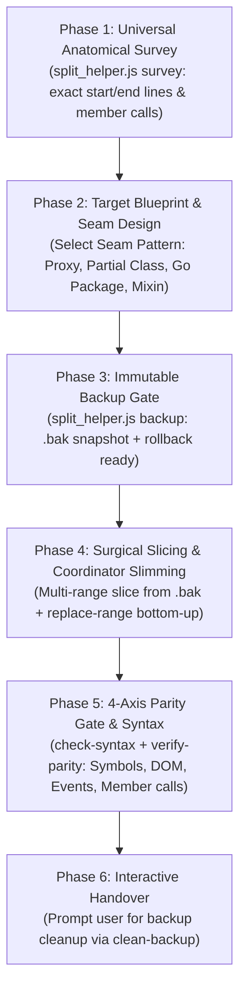

# Monolith Splitter v2.1 (Universal Polyglot Edition)

A zero-hallucination discipline and CLI toolkit for decomposing massive monolithic source files (1,000 to 15,000+ lines across **Python, Java, C#, C++, Go, Rust, PHP, Ruby, TypeScript, JavaScript, Kotlin, Swift**, etc.) into clean, maintainable, modular components.

## Core Tenet: Verbatim Transplant (Zero Rewrite, Zero Token Waste)

```
┌────────────────────────────────────────────────────────────────────────┐
│  REFACTORING A MONOLITH IS A TOPOLOGICAL CHANGE, NOT A LOGIC CHANGE.   │
│  NEVER rewrite, shorten, optimize, or hallucinate code during a split. │
│  Extract code chunks VERBATIM (100% byte-for-byte identical from disk).│
└────────────────────────────────────────────────────────────────────────┘
```

When an agent "rewrites" code to make it "shorter", it routinely drops edge cases, breaks DOM selectors, hallucinates missing utility helpers, alters function signatures, alters Python indentation, and causes runtime crashes. This skill enforces **physical code transplantation** directly from disk without re-generating code tokens through the LLM.

---

## The 6-Phase Protocol v2.1



---

### Phase 1: Universal Anatomical Survey & Dependency Mapping

**Goal**: Inspect the monolithic file to map its structural boundaries, symbols with exact start/end lines, section headers, DOM selectors, event listeners, and member dependencies (`this.*` or `self.*`) before touching any code.

1. **Locate the CLI Helper**:
   The built-in deterministic tool is located at:
   `<skill_dir>/scripts/split_helper.js` (e.g. `~/.gemini/config/skills/monolith-splitter/scripts/split_helper.js`)

2. **Run Survey**:
   ```bash
   node <skill_dir>/scripts/split_helper.js survey "<source_file_path>"
   ```
   This outputs JSON containing:
   - `file`, `language` (Python, C#, Java, Go, Rust, JS, etc.), `family` (indentation vs curly_brace), `totalLines`, `totalBytes`, `detectedEol` (CRLF vs LF).
   - `symbols`: All classes, functions, methods, static methods, getters, setters, structs, types with **exact `startLine`, `endLine`, and `lineCount`** (indentation-based for Python; brace-matched for Java/C#/C++/Go/Rust/JS).
   - `sectionComments`: Major separator headers (e.g. `// ==================...` or `# ==================...`).
   - `domQueries`: All DOM query selectors (`id="..."`, `getElementById`, `querySelector('#...')`) for web files.
   - `eventCountsByType`: Event listeners grouped by event type (`click`, `change`, `input`...).
   - `memberCalls`: Scanned list of all `this.methodName()` or `self.method_name()` invocations for orphan auditing.

**Completion Criterion**: A documented inventory of symbols with exact line ranges (`startLine` to `endLine`) and dependency mapping.

---

### Phase 2: Target Architecture Blueprint & Seam Design

**Goal**: Design a clean, modular folder and file structure adhering to project guidelines, and select the correct Seam Pattern from `references/seam-patterns.md`.

1. **Select the Polyglot Seam Pattern**:
   - **C# / .NET / Unity**: Pattern 2 (Partial Class Seam via `--partial-class <Name> --namespace <Ns>`). Native zero-rewrite compiler support.
   - **Go**: Pattern 3 (Package Directory Seam via `--package <name>`). Sibling files in the directory share package scope with 0 glue code.
   - **Python**: Pattern 4 (Submodule Package Seam with `__init__.py` re-exports, or Mixin decomposition for God classes).
   - **Java / Spring Boot**: Pattern 5 (Spring `@Component` delegate injection).
   - **TypeScript / ES6**: Pattern 1 (Transparent Proxy Seam via `--class-wrapper <Name> --with-proxy-seam`).
   - **Chrome MV3 / Vanilla JS**: Pattern 7 (Coordinator Delegation Seam via `.call(ui, root)`).

2. **Group by Domain Responsibility**:
   - Each domain/sub-feature becomes an independent module file.
   - The original file is slimmed down to a pure **Container / Coordinator Frame** that simply instantiates and orchestrates the child modules.

3. **Present Blueprint to User**:
   Outline the proposed file list, line ranges, and Seam pattern before proceeding.

**Completion Criterion**: A clearly defined mapping table: `[Original Ranges] -> [Target File Path] -> [Class/Component Name] -> [Seam Pattern]`.

---

### Phase 3: Immutable Backup Gate

**Goal**: Guarantee zero data loss by creating a permanent, timestamped snapshot of the original file.

1. **Execute Backup Command**:
   ```bash
   node <skill_dir>/scripts/split_helper.js backup "<source_file_path>"
   ```
2. **Verify Output**:
   The command creates:
   - `<source_file_path>.bak.<timestamp>` (immutable snapshot)
   - `<source_file_path>.bak` (convenience pointer)
   - Outputs file size in bytes, line count, and SHA-256 hash.

> [!TIP]
> If at any point you need to rollback and start over, run:
> ```bash
> node <skill_dir>/scripts/split_helper.js restore "<source_file_path>"
> ```

**Completion Criterion**: Successful execution of `split_helper.js backup` with logged backup file path, line count, and SHA-256 checksum.

---

### Phase 4: Surgical Slicing & Bottom-Up Coordinator Slimming

**Goal**: Physically extract code slices directly from the immutable backup into target files, then slim down the Coordinator bottom-up without shifting line numbers.

1. **Rule 1: Always Slice from the Immutable Backup (`<source>.bak`)**:
   Never slice from a file you are actively editing! The backup snapshot's line numbers never change.

2. **Execute Verbatim Multi-Range Slicing**:
   Support slicing multiple non-contiguous ranges (e.g. lines 274–600 and lines 5200–5850) into a single module with a single command:
   ```bash
   # For JavaScript / TypeScript:
   node <skill_dir>/scripts/split_helper.js slice "<source_file>.bak" 274-600,5200-5850 "<target_file>" \
     --strip-indent \
     --class-wrapper <ClassName> \
     --with-proxy-seam \
     --export-class

   # For C# (.NET):
   node <skill_dir>/scripts/split_helper.js slice "<source_file>.bak" 450-890 "<target_file>" \
     --partial-class <ClassName> \
     --namespace <NamespaceName>

   # For Go:
   node <skill_dir>/scripts/split_helper.js slice "<source_file>.bak" 300-750 "<target_file>" \
     --package <PackageName> \
     --strip-indent

   # For Python / Java / Rust / PHP / Ruby:
   node <skill_dir>/scripts/split_helper.js slice "<source_file>.bak" 150-420 "<target_file>" \
     --strip-indent
   ```

3. **Rule 2: Slim Down the Coordinator Bottom-Up with `replace-range`**:
   To avoid the **Shifting Line Numbers Trap**, replace or remove extracted ranges in the Coordinator file starting from the **highest line number down to the lowest**:
   ```bash
   # Highest range first:
   node <skill_dir>/scripts/split_helper.js replace-range "<coordinator_file>" 5200 5850 \
     --with "    this.tabScan.bindEvents(root);"

   # Then lower range:
   node <skill_dir>/scripts/split_helper.js replace-range "<coordinator_file>" 274 600 \
     --with "    \${this.tabScan.render()}"
   ```
   This replaces lines directly on disk with **0 LLM output tokens** and zero line number drift!

**Completion Criterion**: All target files are created on disk containing the exact original code slices, and the coordinator file properly delegates to them.

---

### Phase 5: 4-Axis Parity Gate & Environment Verification

**Goal**: Mathematically prove that no functions, methods, DOM IDs, event listeners, or member dependencies were lost during modularization.

1. **Polyglot Syntax Check**:
   ```bash
   node <skill_dir>/scripts/split_helper.js check-syntax "<file1>" "<file2>" "<file3>" ...
   ```
   - Checks JS/TS via `node --check` (space-safe with ESM auto-fallback).
   - Checks Python via `python -m py_compile`.
   - Checks PHP via `php -l`.
   - Checks Go via `gofmt -e`.
   - Checks JSON via `JSON.parse`.
   - For Java, C#, C++, Rust, Swift, Kotlin, runs a **Structural Token AST Validator** (verifying balanced `{ }`, `( )`, `[ ]`, and string literals).
   - Every file must return `VALID_SYNTAX`.

2. **The 4-Axis Parity Gate**:
   Run parity comparison against the immutable backup file:
   ```bash
   node <skill_dir>/scripts/split_helper.js verify-parity "<source_file>.bak" "<target_file1>" "<target_file2>" "<coordinator_file>" ...
   ```
   The tool inspects and verifies:
   - **Axis 1: Symbol Parity**: Checks both `missingSymbols` (lost functions across any language) and `duplicateSymbols` (copy-paste collisions).
   - **Axis 2: DOM ID Parity**: Validates 100% of DOM IDs (for web assets; auto-skipped for pure backend files).
   - **Axis 3: Event Listener Parity**: Compares count of event listeners by event type.
   - **Axis 4: Orphan Member Audit**: Flags any `this.methodName()` or `self.method_name()` called in target modules that existed in the original monolith but was not preserved.
   - Must output: `status: FULL_PARITY_VERIFIED` with `100.00% coverage`.

3. **Environment & Manifest Integrity Check (Optional for Extensions)**:
   ```bash
   node <skill_dir>/scripts/split_helper.js validate-env "<project_root>"
   ```

**Completion Criterion**: `check-syntax` passes 100%, and `verify-parity` outputs `status: FULL_PARITY_VERIFIED`.

---

### Phase 6: Interactive Handover & Backup Decision

**Goal**: Report the refactoring outcome clearly to the user and prompt them regarding the backup file.

1. **Present the Refactoring Report**:
   - Monolith size before (e.g. 11,295 lines).
   - Modularized architecture: List of new files created with line counts.
   - Coordinator file size after (clean frame).
   - Verification status: `100.00% 4-Axis Parity Verified`, `0 Syntax Errors`.

2. **Explicitly Ask User About the Backup**:
   > "File splitting completed with 100% verified 4-Axis parity. The original backup is stored at: `<backup_path>`.
   > Would you like to KEEP this backup for safety, or DELETE it to keep the workspace clean?"

3. **Handle User Decision**:
   - If user chooses **Keep**: Confirm the backup path and ensure `*.bak` is in `.gitignore`.
   - If user chooses **Delete**: Execute:
     ```bash
     node <skill_dir>/scripts/split_helper.js clean-backup "<source_file>"
     ```
     This cleans both `.bak` and `.bak.<timestamp>` files.

---

## Forbidden Anti-Patterns (The "Wall of Shame")

- ❌ **The Python Indentation Mangling Trap**: Manually retyping Python blocks and mixing 2 vs 4 spaces or tabs. Always use `--strip-indent` for mathematical indentation preservation.
- ❌ **The C# Partial Class Visibility Trap**: Splitting C# classes without `partial` or with mismatched namespaces. Always use `--partial-class` and `--namespace`.
- ❌ **The Go Package Mismatch Trap**: Declaring conflicting package names in sibling files within the same directory. Always use `--package`.
- ❌ **The Underscore Filename Trap**: Creating temporary files starting with `_` inside Chrome Extensions (strictly reserved by Chromium).
- ❌ **The Shifting Line Numbers Trap**: Slicing top-down while editing in-place. Always slice from `<source>.bak` and replace Coordinator ranges bottom-up!
- ❌ **The Orphan `this` / `self` Trap**: Transplanting methods without a Proxy Seam, Mixin, or context delegation.
- ❌ **The "Concise Rewrite" Trap**: Rewriting a function with shorter logic because you think it's "cleaner" (drops edge cases and null-checks).
- ❌ **The Template Truncation**: Writing `// ... rest of template` or `<!-- TODO -->` in target files.
- ❌ **LLM Memory Re-generation**: Re-typing 2,000 lines through LLM chat output instead of using `slice`.
- ❌ **Skipping Backup**: Modifying the original file without creating a timestamped backup first.
